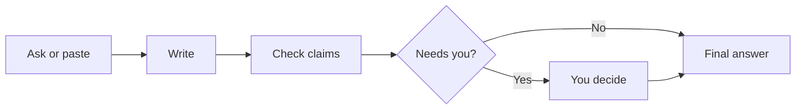

# Ariadne

**Claim-by-claim fact-checking for AI answers — you stay in control.**

Ask a question or paste an answer. One model writes, another checks each key claim against
its sources, and you only decide where a source disagrees. Then you get a final answer with
a claims table.

## How a check works

```text
  Ask or paste          Write               Check              Needs you           Final answer
 ┌─────────────┐   ┌─────────────┐   ┌─────────────┐   ┌─────────────┐   ┌─────────────┐
 │ Question or │ → │ Writer      │ → │ Fact-checker│ → │ You decide  │ → │ Rewritten + │
 │ pasted AI   │   │ drafts with │   │ Supported / │   │ Keep / use  │   │ checked     │
 │ answer      │   │ sources     │   │ Not found / │   │ source /    │   │ again       │
 │             │   │             │   │ Wrong       │   │ remove /    │   │             │
 │  [ Check ]  │   │             │   │             │   │ rewrite     │   │ Export OK   │
 └─────────────┘   └─────────────┘   └─────────────┘   └─────────────┘   └─────────────┘
```



1. **Ask or paste** — one box, one Check button. Type a question, or paste an answer from any AI.
2. **Write** — a writer drafts (or you already pasted the draft).
3. **Check** — a fact-checker marks each key claim: Supported, Not supported, or Wrong.
4. **Needs you** — only claims a source contradicts (at most five) wait for you: Keep it, Use the source’s version, Remove it, or Write my own. Everything else is handled under Checked.
5. **Final answer** — rewritten from your decisions, checked again. Copy it or export PDF / Word / PowerPoint / Markdown.

The principle is simple: the models do the looking; **you** decide what stays.

## Quick start

```bash
git clone https://github.com/saadixsd/Ariadne.git
cd Ariadne
npm install
cp .env.example .env
```

Edit `.env` and add **your own** API keys (never commit `.env`):

| Variable | Required | What it is |
| --- | --- | --- |
| `OPENAI_API_KEY` | Yes | Your OpenAI key (writer / one side of the check) |
| `ANTHROPIC_API_KEY` | Yes | Your Anthropic key (the other model) |
| `ARIADNE_SELF_HOST` | Recommended (`1`) | Lifts multi-tenant daily quotas for local use |
| `OPENAI_MODEL` / `ANTHROPIC_MODEL` | Optional | Defaults are in `.env.example` |
| `TURNSTILE_SECRET` / site key | Optional locally | Sign-up bot guard; empty = off in local/dev |
| `INVITE_CODES` | Optional | Invite-only sign-up when set |
| `CONTACT_EMAIL` | Optional | Help / privacy mailto; otherwise links go to GitHub Issues |
| `NEXT_PUBLIC_SITE_URL` | Optional | Metadata / sitemap base (defaults to `http://localhost:3000`) |

Then:

```bash
npm run db:setup
npm run dev
```

Open [http://localhost:3000](http://localhost:3000), create an account, and press **Check**.

You pay Anthropic and OpenAI directly. Ariadne does not proxy billed model traffic for you.

## Requirements

- Node.js 20+ (or whatever your local Next.js install needs)
- An OpenAI API key and an Anthropic API key
- SQLite locally via Prisma (`DATABASE_URL="file:./dev.db"`)

## Self-host (optional)

The repo includes OpenNext + `wrangler.jsonc` if you want to deploy your own Cloudflare
Worker. That is optional — local `npm run dev` is enough to use the product.

If you deploy:

1. Replace `account_id` and D1 / R2 ids in `wrangler.jsonc` with **yours**.
2. Put `OPENAI_API_KEY` and `ANTHROPIC_API_KEY` as Worker secrets.
3. Set `ARIADNE_SELF_HOST=1`.
4. Add your own routes / DNS. Do not reuse someone else’s account or database ids.

See [`docs/ARCHITECTURE.md`](docs/ARCHITECTURE.md) and [`docs/WORKSPACE.md`](docs/WORKSPACE.md)
for how the app is put together.

## Sample

A finished example lives at [`/sample`](http://localhost:3000/sample) once the app is running.

## License & contact

MIT — see [LICENSE](LICENSE).

Questions, bugs, and ideas: [GitHub Issues](https://github.com/saadixsd/Ariadne/issues).

Built by the Ariadne team.
