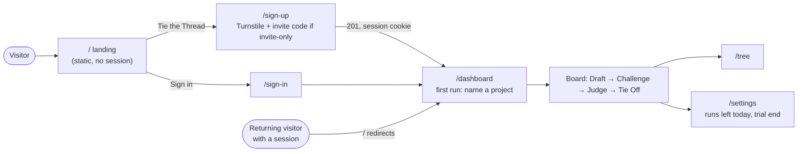

# Ariadne

**Ariadne helps you verify important AI-generated work by having one AI model challenge
another, while you remain the final judge.**

One model drafts, a model from a different family challenges the draft, and you judge:
**Draft → Challenge → Judge → Tie Off.** Nothing moves past a *knot* until you decide.

Live: **https://ariadneagents.si** — a landing page, then sign-up, then the dashboard
(`/dashboard`). One Worker (`ariadne`) serves all of it, since the cutover in
[`docs/CUTOVER.md`](docs/CUTOVER.md). The old early-access page (`landing/`) is retired;
its database is kept as the first invite pool.


## How people get in



- **Open sign-up, guarded.** Cloudflare Turnstile on sign-up (it fails closed in production
  if the secret is missing), per-IP rate limits, and an invite-code switch: set the
  `INVITE_CODES` secret and sign-up becomes invite-only, delete it and it's open again.
- **A small trial.** A new account gets 6 model runs in its first 24 hours (one full pass
  plus one round of changes), then the normal 10 a day. Accounts that signed up with an
  invite code skip the trial cap. Payments come later.
- **Email verification** is built but off: Cloudflare's email sending can't reach arbitrary
  addresses on the Workers Free plan.

## What it does

Each project has a brief (the shared context) and a thread of steps. Every step
belongs to one of three *hands*:

| Hand | Model | Job |
|---|---|---|
| **Odysseus** | Claude (Anthropic) | The Drafter: researches the brief, writes the answer and the final version |
| **Daedalus** | GPT (OpenAI), a different model family | The Challenger: tries to prove the draft wrong (incorrect, unsupported, outdated, contradicted or missing); never writes an answer of its own |
| **You** | Human | The judge. Nothing passes a knot until you tie it off |

A new project starts with a four-step thread (Draft → Challenge → Judge → Tie Off):
**draft (Odysseus) → challenge (Daedalus) → judge at the knot (You) → tied-off writeup (Odysseus)**.
Today each step runs when you press its button. The challenger works from the draft and
what it already knows; points without a source in the draft are labelled Opinion (no web
search on the free Cloudflare plan).

- **Handoffs, not chat.** A step's prompt is its role, the brief, the output of each
  step it depends on, and its instructions. Dependencies decide who works next.
- **The human is the final judge.** At the knot you either tie off (approve) or ask
  for changes. Asking for changes resets the draft and everything after it, adds your
  note to the draft's instructions, and waits for you to press Run again.
- **Nothing is lost.** Every attempt is written to an append-only run history, so
  re-runs and change requests create new versions (v1 → v2 comparison) instead of
  overwriting old ones.
- **Bounded cost.** 10 model runs per account per UTC day (6 in an account's first 24
  hours), reserved atomically before any provider call, and at most 200 runs a day across
  the whole site. Failed runs, approvals and human steps don't count.
- **Self-healing.** A step stuck in `running` for more than 5 minutes is recovered
  the next time anyone reads the project, and its daily run is given back.

## Architecture


| Layer | Choice |
|---|---|
| App | Next.js 16 (App Router), React 19, TypeScript, Tailwind CSS 4 |
| Hosting | Cloudflare Workers via OpenNext (`@opennextjs/cloudflare`) |
| Database | Cloudflare D1 in production, SQLite (`node:sqlite`) locally, through Prisma 6 |
| Models | Anthropic Messages API (Claude), OpenAI Chat Completions (GPT), server-side keys only |
| Auth | Email + password (PBKDF2), hashed 30-day HttpOnly session cookie, Turnstile on sign-up, optional invite codes |
| Deploys | Workers Builds: every push to `main` deploys production |

See **[docs/ARCHITECTURE.md](docs/ARCHITECTURE.md)** for request routing, the sign-up
guards, the run pipeline, the
task state machine and a code map. Diagram sources (Mermaid) and renders are in
[docs/diagrams/](docs/diagrams/), including the
[task state machine](docs/diagrams/03-task-state-machine.png).

## Repository layout

```
app/              Next.js routes: landing (page.tsx, landing.css), dashboard/, tree, settings,
                  sign-in, sign-up, and app/api/** handlers
components/       React UI (board, tree, knot panel, output reader, dialogs)
lib/              Server logic and shared helpers
  agents.ts       the run pipeline: runTask, decideTask (approve / ask for changes), rerunTask
  usage.ts        daily run quotas (per account, first-day trial, site-wide)
  signup-guard.ts Turnstile check and the INVITE_CODES switch for sign-up
  reclaim.ts      stuck-run recovery     starter-thread.ts  the four-step thread (Draft → Challenge → Judge → Tie Off) a new project starts with
  auth.ts         sessions and sign-in   rate-limit.ts      per-IP limits on auth
  prisma.ts       per-request Prisma client (D1 on Workers, SQLite locally)
prisma/           schema.prisma (source of truth) and d1.sql (fresh-database snapshot)
migrations/       D1 migrations, applied with wrangler before deploying code that needs them
tests/unit/        pure-function tests
tests/integration/ pipeline, migration, HTTP and Workers smoke tests (local SQLite or D1 + mock LLM)
public/landing/   life.js: the landing's thread and the Draft → Challenge → Judge → Tie Off demo
landing/          the old early-access Worker (archived after the cutover; keep for its data)
docs/             architecture, security, build log, migrations guide, diagrams, archive
proxy.ts          request gate: / is public (signed-in visitors go to /dashboard), other pages
                  send signed-out visitors to /sign-in, cross-site API writes are refused
next.config.ts    security headers
wrangler.jsonc    Worker config: routes, D1 binding, model names
```

## Run locally

Requires **Node.js 22 or newer** (local dev and tests use the built-in `node:sqlite`).

```sh
cp .env.example .env        # then set OPENAI_API_KEY, ANTHROPIC_API_KEY and the two model names
npm install
npm run db:setup            # creates prisma/dev.db from prisma/schema.prisma
npm run dev                 # http://localhost:3000
```

Open http://localhost:3000, press **Tie the Thread**, sign up, name your first project,
and press **Run** on the first step. Keys stay on the server and are never sent to the
browser.

Locally, Turnstile is off unless you set `TURNSTILE_SECRET`. To try the widget, use
Cloudflare's test keys: `NEXT_PUBLIC_TURNSTILE_SITE_KEY=1x00000000000000000000AA` and
`TURNSTILE_SECRET=1x0000000000000000000000000000000AA` (always passes). Set
`INVITE_CODES="some-code"` to try invite-only mode.

## Tests

```sh
npm test          # unit + pipeline + migration tests (temporary SQLite DB, mock LLM)
npm run test:all  # adds dev-server HTTP checks and wrangler's local D1 (needs free ports 3197/4197)
npm run lint
npm run build
```

No test ever calls a real model provider or a remote database.

## Deploy

- Production deploys from `main` through Cloudflare Workers Builds.
- Schema changes ship as the next `migrations/000N_*.sql`, applied with
  `npx wrangler d1 migrations apply ariadne --remote` **before** the code that needs
  them. See [docs/MIGRATIONS.md](docs/MIGRATIONS.md).
- API keys and `TURNSTILE_SECRET` are Worker secrets (`wrangler secret put`), never in the
  repo. `INVITE_CODES` is an optional secret; adding or deleting it flips invite-only mode
  without a deploy.

## Security

Session tokens are stored hashed, and every query is scoped to the signed-in user.
Sign-up needs a Turnstile pass, auth endpoints are rate-limited per IP, API writes from other sites are refused,
inputs are capped server-side, model output is rendered without raw HTML, generated
pages open in a sandboxed iframe, and every response carries standard security headers.
Details and known limitations: [docs/SECURITY.md](docs/SECURITY.md).

## Status

Phase 0 (landing, open sign-up, `/dashboard`) is built. Next: answer-first drafts, a
one-click Challenge where the challenger can search the web and ties every objection to a
claim and a source, and judging objections one by one (Phases 1–3). Deliberately **not**
being built: bring-your-own-key, more models, agent debate, teams, a marketplace,
autonomous workflows.

Built by Saad Kashif, with AI coding assistants used during development.
History and verification notes: [CHANGELOG.md](CHANGELOG.md),
[docs/PROJECT_LOG.md](docs/PROJECT_LOG.md). Early planning documents are kept in
[docs/archive/](docs/archive/).

## License

MIT, see [LICENSE](LICENSE).
