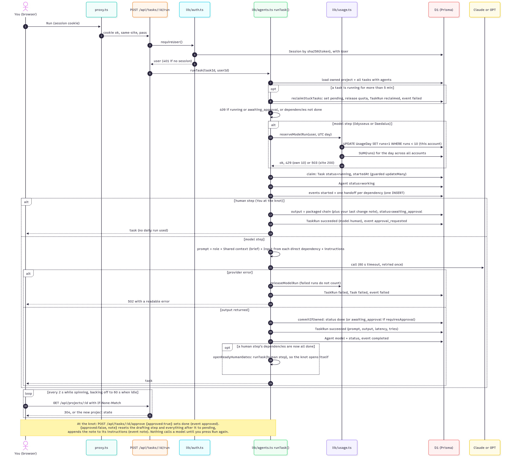
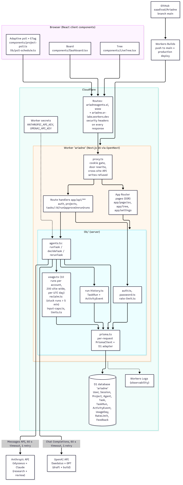

# Ariadne

**Ariadne takes the human middleware out of working with several AI models.**
It coordinates two models on one piece of work, passing shared context and handoffs
between them, and stops at a *knot* for a human decision before anything moves on.

Live: **https://ariadneagents.si**



## What it does

Each project has a brief (the shared context) and a thread of steps. Every step
belongs to one of three *hands*:

| Hand | Model | Job |
|---|---|---|
| **Odysseus** | Claude (Anthropic) | Researches and reviews: reads the thread, investigates, critiques |
| **Daedalus** | GPT (OpenAI) | Drafts and builds: writes, generates, produces the artifact |
| **You** | Human | Holds the thread. Nothing passes a knot until you tie it off |

A new project starts with a five-step thread:
**research (Odysseus) → draft (Daedalus) → review (Odysseus) → knot (You) → produce (Daedalus)**.

- **Handoffs, not chat.** A step's prompt is its role, the brief, the output of each
  step it depends on, and its instructions. Dependencies decide who works next.
- **The human is the final judge.** At the knot you either tie off (approve) or ask
  for changes. Asking for changes resets the draft and everything after it, adds your
  note to the draft's instructions, and waits for you to press Run again.
- **Nothing is lost.** Every attempt is written to an append-only run history, so
  re-runs and change requests create new versions (v1 → v2 comparison) instead of
  overwriting old ones.
- **Bounded cost.** 10 model runs per account per UTC day, reserved atomically before
  any provider call, and at most 200 runs a day across the whole site. Failed runs,
  approvals and human steps don't count.
- **Self-healing.** A step stuck in `running` for more than 5 minutes is recovered
  the next time anyone reads the project, and its daily run is given back.

## Architecture



| Layer | Choice |
|---|---|
| App | Next.js 16 (App Router), React 19, TypeScript, Tailwind CSS 4 |
| Hosting | Cloudflare Workers via OpenNext (`@opennextjs/cloudflare`) |
| Database | Cloudflare D1 in production, SQLite (`node:sqlite`) locally, through Prisma 6 |
| Models | Anthropic Messages API (Claude), OpenAI Chat Completions (GPT), server-side keys only |
| Auth | Email + password (PBKDF2), hashed 30-day HttpOnly session cookie |
| Deploys | Workers Builds: every push to `main` deploys production |

See **[docs/ARCHITECTURE.md](docs/ARCHITECTURE.md)** for the run pipeline, the
task state machine and a code map. Diagram sources (Mermaid) and renders are in
[docs/diagrams/](docs/diagrams/), including the
[task state machine](docs/diagrams/03-task-state-machine.png).

## Repository layout

```
app/              Next.js routes: pages (board, tree, settings, sign-in) and app/api/** handlers
components/       React UI (board, tree, knot panel, output reader, dialogs)
lib/              Server logic and shared helpers
  agents.ts       the run pipeline: runTask, decideTask (approve / ask for changes), rerunTask
  usage.ts        daily run quotas (per account and site-wide)
  reclaim.ts      stuck-run recovery     starter-thread.ts  the five-step thread a new project starts with
  auth.ts         sessions and sign-in   rate-limit.ts      per-IP limits on auth
  prisma.ts       per-request Prisma client (D1 on Workers, SQLite locally)
prisma/           schema.prisma (source of truth) and d1.sql (fresh-database snapshot)
migrations/       D1 migrations, applied with wrangler before deploying code that needs them
tests/unit/        pure-function tests
tests/integration/ pipeline, migration, HTTP and Workers smoke tests (local SQLite or D1 + mock LLM)
docs/             architecture, security, build log, migrations guide, diagrams, archive
proxy.ts          request gate: signed-out visitors go to /sign-in, cross-site API writes are refused
next.config.ts    security headers
wrangler.jsonc    Worker config: routes, D1 binding, model names
```

## Run locally

Requires **Node.js 22 or newer** (local dev and tests use the built-in `node:sqlite`).

```sh
cp .env.example .env        # then set OPENAI_API_KEY, ANTHROPIC_API_KEY and the two model names
npm install
npm run db:setup            # creates prisma/dev.db from prisma/schema.prisma
npm run dev                 # http://localhost:3000
```

Sign up, name your first project, and press **Run** on the first step. Keys stay on
the server and are never sent to the browser.

## Tests

```sh
npm test          # unit + pipeline + migration tests (temporary SQLite DB, mock LLM)
npm run test:all  # adds dev-server HTTP checks and wrangler's local D1 (needs free ports 3197/4197)
npm run lint
npm run build
```

No test ever calls a real model provider or a remote database.

## Deploy

- Production deploys from `main` through Cloudflare Workers Builds.
- Schema changes ship as the next `migrations/000N_*.sql`, applied with
  `npx wrangler d1 migrations apply ariadne --remote` **before** the code that needs
  them. See [docs/MIGRATIONS.md](docs/MIGRATIONS.md).
- API keys are Worker secrets (`wrangler secret put`), never in the repo.

## Security

Session tokens are stored hashed, and every query is scoped to the signed-in user.
Auth endpoints are rate-limited per IP, API writes from other sites are refused,
inputs are capped server-side, model output is rendered without raw HTML, generated
pages open in a sandboxed iframe, and every response carries standard security headers.
Details and known limitations: [docs/SECURITY.md](docs/SECURITY.md).

## Status

V1 is live. Deliberately **not** built yet: agent debate, a model picker,
bring-your-own-key, autonomous reruns.

Built by Saad Kashif, with AI coding assistants used during development.
History and verification notes: [CHANGELOG.md](CHANGELOG.md),
[docs/PROJECT_LOG.md](docs/PROJECT_LOG.md). Early planning documents are kept in
[docs/archive/](docs/archive/).

## License

MIT, see [LICENSE](LICENSE).
