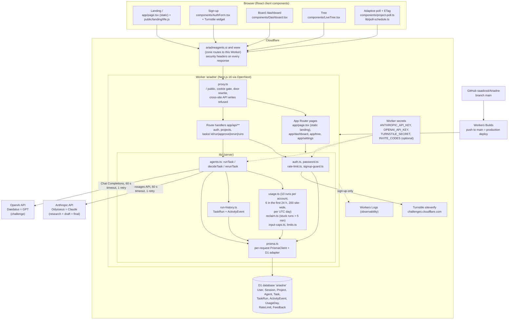
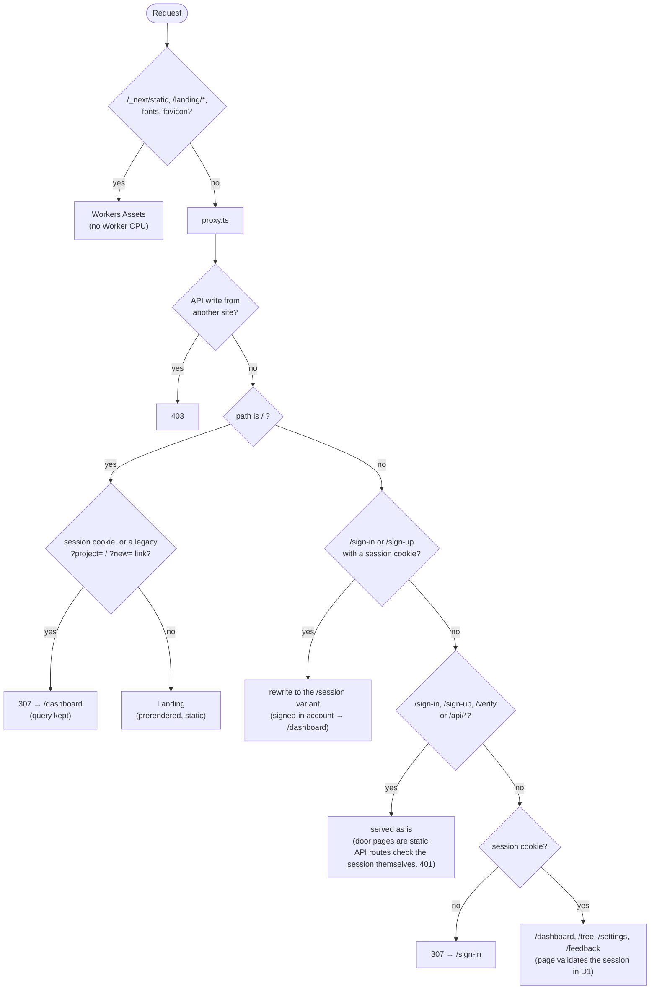
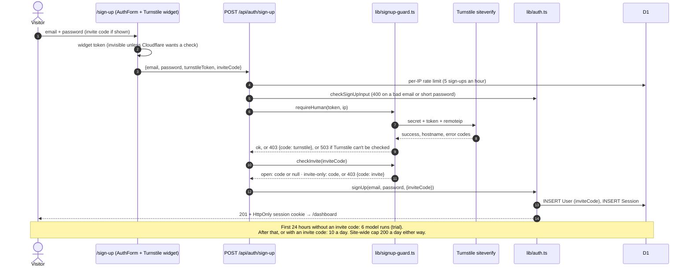
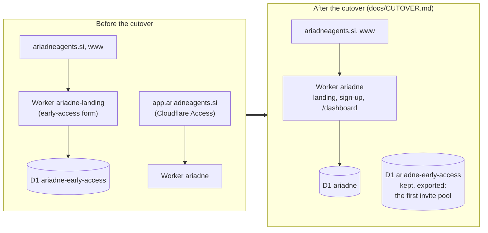
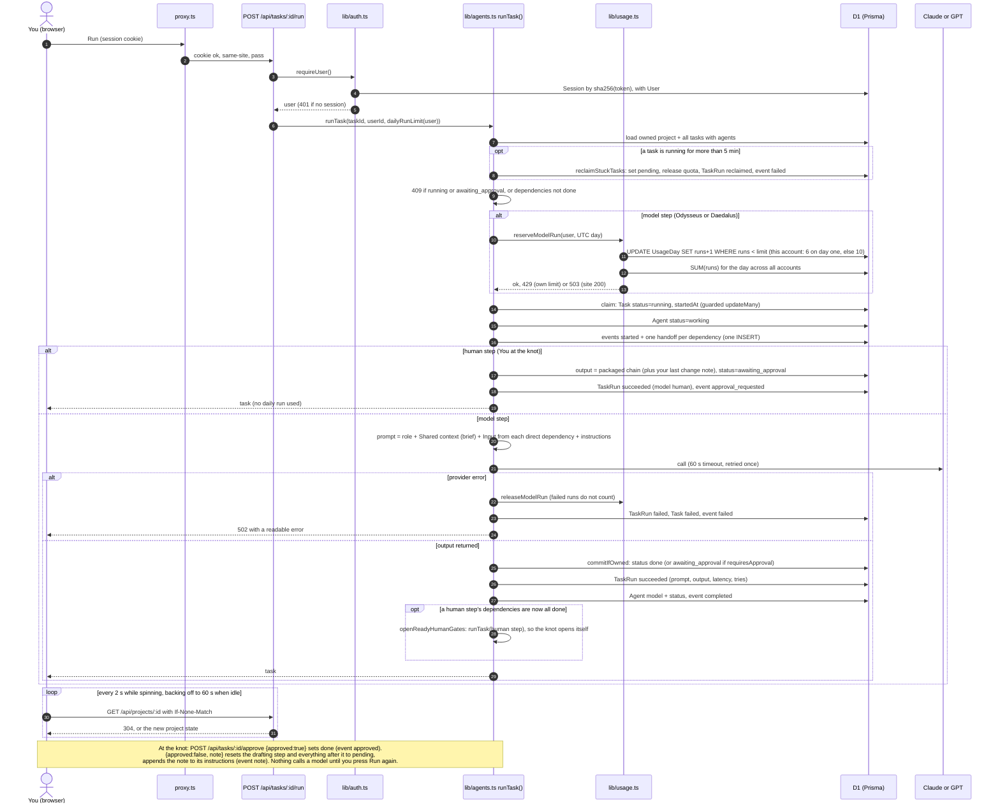
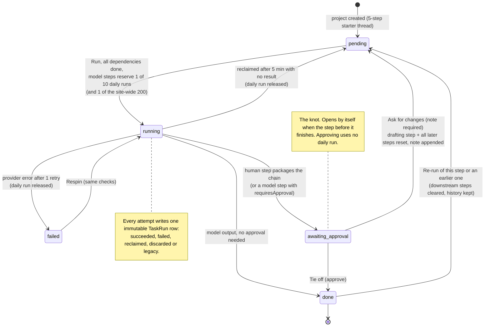

# Architecture

Ariadne is one Next.js 16 app compiled for Cloudflare Workers by OpenNext. The browser
talks to a single Worker (`ariadne`) on ariadneagents.si. The Worker serves the landing
page, sign-up and the dashboard, the JSON API, stores everything in one D1 database and
calls Anthropic and OpenAI with server-side keys.

The product's wedge is **Draft → Challenge → Judge → Tie Off**: Odysseus (Claude) drafts,
Daedalus (GPT, a different model family) challenges, you judge, and the approved
answer is tied off with its history.

## 1. System



Rendered: [`docs/diagrams/01-system-architecture.png`](diagrams/01-system-architecture.png)

- **Edge of the Worker.** Every response carries security headers (HSTS, `nosniff`,
  `Referrer-Policy`, `X-Frame-Options: DENY`, `frame-ancestors 'none'`,
  `Permissions-Policy`) from `next.config.ts` (static files under `/_next/static` get
  the same core headers from `public/_headers`, since Workers Assets serves them without
  running the Worker), and no `X-Powered-By`. `proxy.ts` serves `/`
  to everyone, sends signed-out visitors on other pages to `/sign-in`, and refuses API
  writes whose `Origin` is another site.
- **One request, one Prisma client.** On Workers, `lib/prisma.ts` creates a Prisma
  client per request (keyed on OpenNext's request context). A shared client batched
  two requests' queries into one, so when one request ended the other could hang.
- **No background workers.** Runs happen inside the HTTP request (at most about 2 min:
  60 s timeout, 1 retry). Recovery is lazy, with no cron (see section 7).
- **Polling, not sockets.** The board polls `GET /api/projects/:id` with an ETag:
  every 2 s while something is running, backing off to once a minute when idle,
  and not at all in a hidden tab (`lib/poll-schedule.ts`, `lib/project-version.ts`).

## 2. Requests and routing



Rendered: [`docs/diagrams/04-request-routing.png`](diagrams/04-request-routing.png)

- **The landing costs no database or render work.** `/` is prerendered at build time, so
  a signed-out visit runs `proxy.ts` (a cookie check) and OpenNext returns the prerendered
  HTML. That matters on the Workers Free plan's 10 ms CPU limit.
- **Old links keep working.** `/?project=…&new=1` from before the move goes to
  `/dashboard?project=…&new=1`.
- `proxy.ts` only checks that the cookie exists; the page validates the session against
  D1 and sends a stale cookie to `/sign-in`. A stale cookie on `/` therefore costs one extra
  redirect (`/` → `/dashboard` → `/sign-in`), never a wrong page.

## 3. Sign-up



Rendered: [`docs/diagrams/05-sign-up-sequence.png`](diagrams/05-sign-up-sequence.png)

- **Turnstile fails closed in production.** With no `TURNSTILE_SECRET` the server refuses
  sign-ups (503) rather than letting bots through. Outside production, no secret means
  Turnstile is off, so local dev and tests work without keys.
- **Invite switch.** `INVITE_CODES` is a comma list (case-insensitive, multi-use). When
  it's set, sign-up needs one of the codes; `?invite=CODE` on the sign-up URL fills it in.
  OpenNext copies Worker secrets into `process.env` on each request, so adding or deleting
  the secret takes effect without a deploy.
- **Trial.** `lib/limits.ts` `dailyRunLimit(user)`: 6 while `now − createdAt < 24 h` and
  the account has no invite code, else 10. `lib/usage.ts` reserves against that limit with
  the same atomic `UPDATE … WHERE runs < limit`. Settings shows when the trial ends.

## 4. Hosting



Rendered: [`docs/diagrams/06-hosting-cutover.png`](diagrams/06-hosting-cutover.png)

A route pattern can belong to only one Worker, so the order is: take the routes off
`ariadne-landing`, then attach them to `ariadne`, then remove `app.` and its Access app.
The steps, checks and rollback are in [CUTOVER.md](CUTOVER.md).

## 5. A run, step by step



Rendered: [`docs/diagrams/02-run-pipeline-sequence.png`](diagrams/02-run-pipeline-sequence.png)

The prompt a model step receives (`lib/prompt.ts`):

```
system: <agent role>\n\nYou are <Odysseus|Daedalus>, an agent in the Ariadne coordination layer.
user:   ## Shared context\n<project brief>
        ## Input from <hand> (<step title>): <that step's output>     (one per direct dependency)
        <step instructions, including any "Human requested changes: …" notes>
```

A human step (the knot) never calls a model. It packages every finished step upstream
of it, plus your last change note, and waits in `awaiting_approval`.

## 6. Task states



Rendered: [`docs/diagrams/03-task-state-machine.png`](diagrams/03-task-state-machine.png)

| Event type (`ActivityEvent.type`) | Written when |
|---|---|
| `started` | a step is claimed for a run |
| `handoff` | once per dependency whose output feeds the step (`fromTaskId` → `toTaskId`) |
| `completed` | a model step finishes and needs no approval |
| `approval_requested` | a knot opens (`payload.gate = true` for a human step) |
| `approved` | you tie off a knot |
| `note` | you ask for changes (`payload.decision = "changes_requested"`) or a re-run clears steps (`payload.kind = "rerun_cleared"`) |
| `failed` | a provider error, or a stuck run recovered (`payload.reason = "stuck_run_reclaimed"`) |

`TaskRun` is append-only: one row per attempt with outcome `succeeded`, `failed`,
`reclaimed`, `discarded` (it finished after being recovered, so its output is kept but not
applied) or `legacy` (output saved from before run history existed).

## 7. Guards

| Guard | Where | Rule |
|---|---|---|
| Daily quota | `lib/usage.ts` | `UPDATE UsageDay SET runs = runs + 1 WHERE runs < limit` before the provider call. It's released on failure, discard or recovery, so only successful runs count. Per user, per UTC day (429 when used up) |
| First-day trial | `lib/limits.ts` | the limit is 6 for an account's first 24 hours unless it signed up with an invite code, then 10 |
| Sign-up | `lib/signup-guard.ts` | Turnstile siteverify (403 on failure, 503 if it can't be checked; fails closed in production), then the `INVITE_CODES` switch (403 when invite-only and the code is missing or wrong) |
| Site-wide cap | `lib/usage.ts`, `lib/limits.ts` | after the user's run is reserved, the day's `SUM(runs)` across all accounts must be ≤ 200, or the reservation is given back and the run is refused with 503 before any provider call. Resets at midnight UTC. Bounds the worst-case daily spend no matter how many accounts exist |
| Output size | `lib/agents.ts`, `lib/limits.ts` | `max_tokens` 8,192 on Claude (unchanged) and `max_completion_tokens` 16,384 on GPT (the same visible budget plus headroom, since a reasoning model's hidden tokens count too). GPT calls had no cap before |
| Cross-site writes | `proxy.ts` | POST/PATCH/DELETE to `/api/*` with a foreign `Origin` (or `Sec-Fetch-Site: cross-site`) gets 403 |
| Ownership | every query | `userId` is in the `WHERE` of every project/task read and write. Someone else's id returns 404 |
| Run claim | `lib/agents.ts` | the claim is a guarded `updateMany` (not running, not awaiting approval). Results are written only if this attempt still owns the step (`commitIfOwned`) |
| Stuck runs | `lib/reclaim.ts` | `running` for more than 5 min → `pending`. Checked when the board loads, on polls, and on run, approve and re-run |
| Auth rate limits | `lib/rate-limit.ts` | per IP (`cf-connecting-ip`), fixed 1 h windows: sign-up 5, sign-in 10, verify 20 |
| Input caps | `lib/limits.ts` | brief 5,000 · project name 120 · title 200 · instructions 5,000 · note 2,000 · feedback 4,000 characters |

## 8. Data model (`prisma/schema.prisma`)

`User` (with `inviteCode`, null for open sign-ups) 1─* `Session`, `UsageDay`, `Project`, `Feedback` · `Project` 1─* `Agent`, `Task`,
`ActivityEvent` · `Task` 1─* `TaskRun` · `RateLimit` (standalone counters). Deleting
a project cascades to its agents, tasks, runs and events. `Task.dependsOn` is a JSON
array of task ids.

## 9. Code map

| Path | What it is |
|---|---|
| `app/page.tsx`, `app/landing.css`, `public/landing/life.js` | the static landing page and its thread and demo script |
| `app/dashboard/page.tsx`, `app/tree/page.tsx` | Board and Tree pages (server-rendered, then client components take over) |
| `app/api/tasks/[id]/run\|approve\|rerun\|runs` | the pipeline endpoints |
| `app/api/projects/**` | project CRUD, add step, ETag poll, events |
| `app/api/auth/**`, `app/api/account` | sign-up/in/out, email verification (dormant), name |
| `lib/signup-guard.ts`, `lib/turnstile-site-key.ts` | Turnstile check and invite switch (server); the public site key (browser) |
| `lib/one-liner.ts` | the one-liner and the four wedge steps, shared by the landing and the first-run dialog |
| `lib/agents.ts` | `runTask`, `decideTask`, `rerunTask`, provider calls |
| `lib/starter-thread.ts` | the five-step starter thread and the three hands |
| `lib/usage.ts`, `lib/limits.ts`, `lib/reclaim.ts`, `lib/run-history.ts` | per-user (with the first-day trial) and site-wide quota, recovery, history and events |
| `lib/thread.ts`, `lib/lineage.ts`, `lib/live-tree.ts`, `lib/dag-layout.ts` | browser-safe view models for the Board and Tree |
| `components/Dashboard.tsx`, `components/LiveTree.tsx` | Board and Tree client roots |
| `components/KnotPanel.tsx`, `components/Critique.tsx` | knot sheet, review flags, v1 → v2 |
| `proxy.ts` | `/` is public (signed-in visitors and legacy links go to `/dashboard`), other pages redirect signed-out visitors to `/sign-in`, refuses cross-site API writes |
| `next.config.ts` | security headers, `poweredByHeader: false` |
| `tests/unit`, `tests/integration` | unit tests; pipeline, migration, HTTP and Workers smoke tests (mock LLM, local SQLite or local D1) |
| `migrations/` | D1 migrations 0001 to 0004 |
