# Workspace, feedback and outreach attribution (Oct 14 2026)

What was added on branch `workspace-v2`, how it fits together, and what has to happen before it goes live.

## How it works

```mermaid
flowchart LR
  E(["Outreach email<br/>?ref=r-…&utm_campaign=…"]) --> L["/ landing<br/>proxy.ts keeps ref in a 30-day cookie"]
  L --> SU["/sign-up<br/>signed ref → User.refCode<br/>(invite-level run limit)"]
  SU --> D["/dashboard"]
  D -- "no projects" --> N["/new<br/>goal + files → text read in browser<br/>→ brief → Confirm (runs nothing)"]
  D -- "has projects" --> W
  N --> W["/p/[id] Workspace"]
  W --> R["Draft and Challenge<br/>(2 runs, on click)"]
  R --> J["Judge: Accept / Reject / Edit /<br/>Needs investigation per issue"]
  J -- "Revise with accepted issues<br/>(= Ask for changes)" --> R
  J -- "Tie off" --> T["Write the tied-off answer (1 run)"]
  T --> A["Approve deliverable<br/>(explicit, hash of what you saw)"]
  A --> F["Opt-in: Want to share feedback?"]
  F --> FB[("Feedback<br/>rating, 3 answers, project, app version")]
  FB --> AD["/admin/feedback<br/>ADMIN_EMAILS only"]
  W -. "Advanced views" .-> B["Board / Tree (unchanged)"]
```



```
┌ Ariadne · project name · [state] · New · Advanced views ▾ · Feedback ──────────────┐
│ Goal          │ [ next explicit action button · cost in runs ]   │ Issues from Daedalus│
│ Sources (text │ Draft · Odysseus (Claude)                        │ Open · Investigating│
│  read, not    │ readable document; quoted claims highlighted,    │ · Resolved          │
│  checked)     │ click → issue card                               │ claim / why /       │
│ Brief (edit)  │                                                  │ evidence or Opinion │
│               │                                                  │ Accept Reject Edit  │
├───────────────┴──────────────────────────────────────────────────┴─────────────────────┤
│ ▸ Agent activity: Draft done · Challenge done · Judge waiting on you · Tie Off not run │
└────────────────────────────────────────────────────────────────────────────────────────┘
Phone (<1024px): tabs Document | Issues | Sources; activity bar at the bottom.
```

## Pieces

| Piece | Where |
|---|---|
| Campaign capture, signed ref codes | `proxy.ts`, `lib/campaign.ts`, `app/api/auth/sign-up/route.ts`, `scripts/ref-codes.mjs` |
| Outreach accounts skip the trial cap | `lib/limits.ts` (`refCode` counts like `inviteCode`) |
| App version on feedback | `next.config.ts` (`NEXT_PUBLIC_APP_VERSION` = commit) |
| Metrics (no dashboard) | `scripts/metrics.sql`: funnel by campaign, daily starts/approvals/runs, repeat users, ratings |
| Feedback v2 | `lib/feedback.ts`, `app/api/feedback/*`, `components/FeedbackForm.tsx`, `app/feedback/page.tsx` |
| Admin | `lib/admin.ts`, `app/admin/feedback/*`, `app/api/admin/feedback/[id]` |
| Workspace | `app/p/[id]`, `components/{Workspace,SourcesPanel,IssuesPanel,ActivityPanel}.tsx`, `lib/workspace.ts` (pure), `lib/workspace-server.ts` |
| Upload → brief | `app/new`, `components/NewProjectFlow.tsx`, `lib/ingest-client.ts`, `lib/sources.ts`, `public/vendor/` (pdf.js 4.10.38 Apache-2.0, mammoth 1.13.0 BSD-2) |
| Agent execution | unchanged except one line: `lib/agents.ts` adds source text to the shared context (`briefWithSources`) |

Rules kept: nothing runs without a click, and every button that runs a model says how many runs it uses. Reading a file is not checking it. Resolving issues is not approving the deliverable. Approval is a separate step, allowed with open issues after a warning, and it names the exact text approved (a hash). If the text changes, the approval no longer applies. Daedalus is described as a second model, not an authority. When a dispute has no source in the draft it is labelled Opinion.

## Privacy

- Ref codes carry no name or email. Only the outreach sheet maps a code to a person.
- Original files never reach the server. Only the extracted text is saved, up to 40k characters per file, 80k per project and 5 files. That text is deleted with the project, and the project is deleted with the account.
- `/admin/feedback` shows no emails. A project behind a feedback row shows only its steps and counts unless the person ticked "Saad may open this project".
- Feedback older than 12 months is anonymised (person and project links dropped) each time the admin page loads.
- `scripts/metrics.sql` reads counts and states only, never briefs, outputs or source text.

## Before pushing to main (production)

1. Apply the migrations to production D1, in order, **before** the push:
   ```
   npx wrangler d1 migrations list ariadne --remote      # expect 0005, 0006 pending
   npx wrangler d1 migrations apply ariadne --remote     # applies 0005_attribution_feedback, 0006_workspace
   ```
   Both are additive: new nullable columns, one boolean with a default, and two new tables.
2. Secrets:
   - `npx wrangler secret put ADMIN_EMAILS` with Saad's address. Without it, nobody can open the admin page.
   - `npx wrangler secret put REF_SECRET` with a long random value. Without it, ref codes are recorded but do not lift the trial cap.
3. Make ref codes with `REF_SECRET=… node scripts/ref-codes.mjs 50 researchers-w1 > wave1.csv`. Keep the CSV outside the repo.

## Pending Saad's confirmation (not built; seams noted)

- **R2 per-user file storage, deleted after 3 days.** The seam is `addSources` in `lib/workspace-server.ts`, plus the `sources` POST route. A new migration would add `SourceFile.blobKey` and `expiresAt`. A bucket lifecycle rule would delete objects after 3 days. Parsing stays in the browser either way. Today the file itself is never stored.
- **Quota per workflow (6 per user, about 10 reruns or Intervenes inside a workflow free).** The seams are `dailyRunLimit` (`lib/limits.ts`) and `reserveModelRun`/`releaseModelRun` (`lib/usage.ts`), both called only from `runTask` in `lib/agents.ts`. A workflow could be counted on the first Draft run of a project (`TaskRun` attempt 1 of the draft step), with a per-project counter for the reruns. Current per-run quota logic is unchanged.
