# Workspace, feedback and outreach attribution (Oct 14 2026)

What was added on branch `workspace-v2`, how it fits together, and what has to happen before it goes live.

## How it works

```mermaid
flowchart LR
  E(["Outreach email<br/>?ref=r-…&utm_campaign=…"]) --> L["/ landing<br/>proxy.ts keeps ref in a 30-day cookie"]
  L --> SU["/sign-up<br/>signed ref → User.refCode<br/>(invite-level run limit)"]
  SU --> D["/dashboard"]
  D -- "no projects" --> N["/new<br/>goal + files → text read in browser<br/>→ brief → Confirm (runs nothing)"]
  D -- "has projects" --> W
  N --> W["/p/[id] Workspace"]
  N -. "original bytes, 3 days" .-> R2[("R2 ariadne-uploads<br/>u/userId/…")]
  W --> R["Draft and Challenge<br/>(2 runs, on click)"]
  R --> J["Judge: Accept / Reject / Edit /<br/>Needs investigation per issue"]
  J -- "Revise with accepted issues<br/>(= Ask for changes)" --> R
  J -- "Tie off" --> T["Write the tied-off answer (1 run)"]
  T --> A["Approve deliverable<br/>(explicit, hash of what you saw)"]
  A --> F["Opt-in: Want to share feedback?"]
  F --> FB[("Feedback<br/>rating, 3 answers, project, app version")]
  FB --> AD["/admin/feedback<br/>ADMIN_EMAILS only"]
  W -. "Advanced views" .-> B["Board / Tree (unchanged)"]
```



```
┌ Ariadne · project name · [state] · New · Advanced views ▾ · Feedback ──────────────┐
│ Goal          │ [ next explicit action button · cost in runs ]   │ Issues from Daedalus│
│ Sources (text │ Draft · Odysseus (Claude)                        │ Open · Investigating│
│  read, not    │ readable document; quoted claims highlighted,    │ · Resolved          │
│  checked)     │ click → issue card                               │ claim / why /       │
│ Brief (edit)  │                                                  │ evidence or Opinion │
│               │                                                  │ Accept Reject Edit  │
├───────────────┴──────────────────────────────────────────────────┴─────────────────────┤
│ ▸ Agent activity: Draft done · Challenge done · Judge waiting on you · Tie Off not run │
└────────────────────────────────────────────────────────────────────────────────────────┘
Phone (<1024px): tabs Document | Issues | Sources; activity bar at the bottom.
```

## Pieces

| Piece | Where |
|---|---|
| Campaign capture, signed ref codes | `proxy.ts`, `lib/campaign.ts`, `app/api/auth/sign-up/route.ts`, `scripts/ref-codes.mjs` |
| Outreach accounts skip the trial cap | `lib/limits.ts` (`refCode` counts like `inviteCode`) |
| App version on feedback | `next.config.ts` (`NEXT_PUBLIC_APP_VERSION` = commit) |
| Metrics (no dashboard) | `scripts/metrics.sql`: funnel by campaign, daily starts/approvals/runs, repeat users, ratings |
| Feedback v2 | `lib/feedback.ts`, `app/api/feedback/*`, `components/FeedbackForm.tsx`, `app/feedback/page.tsx` |
| Admin | `lib/admin.ts`, `app/admin/feedback/*`, `app/api/admin/feedback/[id]` |
| Workspace | `app/p/[id]`, `components/{Workspace,SourcesPanel,IssuesPanel,ActivityPanel}.tsx`, `lib/workspace.ts` (pure), `lib/workspace-server.ts` |
| Original files (R2, 3 days) | `lib/file-store.ts`, `app/api/projects/[id]/sources/[sourceId]/file`, `wrangler.jsonc` `r2_buckets` |
| Workflow quota | `lib/usage.ts`, `lib/limits.ts`, `Workflow` table |
| Upload → brief | `app/new`, `components/NewProjectFlow.tsx`, `lib/ingest-client.ts`, `lib/sources.ts`, `public/vendor/` (pdf.js 4.10.38 Apache-2.0, mammoth 1.13.0 BSD-2) |
| Agent execution | unchanged except one line: `lib/agents.ts` adds source text to the shared context (`briefWithSources`) |

Rules kept: nothing runs without a click, and every button that runs a model says how many runs it uses. Reading a file is not checking it. Resolving issues is not approving the deliverable. Approval is a separate step, allowed with open issues after a warning, and it names the exact text approved (a hash). If the text changes, the approval no longer applies. Daedalus is described as a second model, not an authority. When a dispute has no source in the draft it is labelled Opinion.

## Privacy

- Ref codes carry no name or email. Only the outreach sheet maps a code to a person.
- Original files are kept in R2 for 3 days under the owner's prefix, then deleted. The extracted text (up to 40k characters per file, 80k per project, 5 files) stays in D1 with the project and is deleted with it.
- `/admin/feedback` shows no emails. A project behind a feedback row shows only its steps and counts unless the person ticked "Saad may open this project".
- Feedback older than 12 months is anonymised (person and project links dropped) each time the admin page loads.
- `scripts/metrics.sql` reads counts and states only, never briefs, outputs or source text.

## Before pushing to main (production)

1. Apply the migrations to production D1, in order, **before** the push:
   ```
   npx wrangler d1 migrations list ariadne --remote      # expect 0005, 0006, 0007 pending
   npx wrangler d1 migrations apply ariadne --remote     # 0005_attribution_feedback, 0006_workspace, 0007_r2_workflow_quota
   ```
   All three are additive: new nullable columns, one boolean with a default, and three new tables (IssueDecision, SourceFile, Workflow).
   Then create the R2 bucket and its lifecycle rule (see the R2 section above).
2. Secrets:
   - `npx wrangler secret put ADMIN_EMAILS` with Saad's address. Without it, nobody can open the admin page.
   - `npx wrangler secret put REF_SECRET` with a long random value. Without it, ref codes are recorded but do not lift the trial cap.
3. Make ref codes with `REF_SECRET=… node scripts/ref-codes.mjs 50 researchers-w1 > wave1.csv`. Keep the CSV outside the repo.

## Quota: workflows, not runs (confirmed Oct 13)

- Each account can start **10 workflows per UTC day** (`WORKFLOWS_PER_DAY`). A workflow is one Draft → Challenge → Judge → Tie Off pass on a project. It opens on the first model run of a project and closes when the deliverable is approved. The next model run on that project after approval opens a new workflow.
- Model runs inside an open workflow (reruns, Intervene, revisions) don't count against the 10. A hidden cap of 13 runs per workflow (3 for a full pass + 10 reruns, `MAX_RUNS_PER_WORKFLOW`) stops runaway loops. The message tells the user to approve or start a new project.
- A workflow whose only runs failed is removed, so a provider error never uses one up.
- The site-wide ceiling of **200 model runs per UTC day** is unchanged and still counts every run (`UsageDay`).
- The day-one trial (6 runs) and the 10 runs per day no longer apply to the Workspace/Board/Tree paths. `dailyRunLimit` is kept only for the legacy reservation path the tests still exercise.
- Code: `lib/usage.ts` (`reserveModelRun(..., projectId)`, `closeWorkflow`, `workflowsLeft`), `lib/limits.ts`, `Workflow` table (migration 0007).

## Original files in R2 (confirmed Oct 13)

- Text is still extracted in the browser; the Worker never parses files. The original bytes are PUT to `/api/projects/[id]/sources/[sourceId]/file` and stored in the R2 bucket `ariadne-uploads` (binding `FILES`) at `u/<userId>/<projectId>/<sourceId>`, one prefix per user.
- `SourceFile.expiresAt` is upload time + 3 days. After that the app stops offering the download, and the bucket lifecycle rule deletes the object. Removing a source or deleting a project deletes its originals right away.
- Without the binding (local dev, previews) originals are not kept and the UI says so; everything else works.

### Production setup for R2 (before the deploy that carries `r2_buckets`)

```
npx wrangler r2 bucket create ariadne-uploads
npx wrangler r2 bucket lifecycle add ariadne-uploads delete-originals-after-3-days u/ --expire-days 3
npx wrangler r2 bucket lifecycle list ariadne-uploads     # check the rule
```
Without the bucket the deploy fails, because wrangler checks bindings. The bucket stays private: there is no public access and no r2.dev URL, and downloads go through the owner-checked route. R2 deletes objects after the lifecycle age asynchronously, usually within a day, and the app stops offering the file at 3 days regardless.
